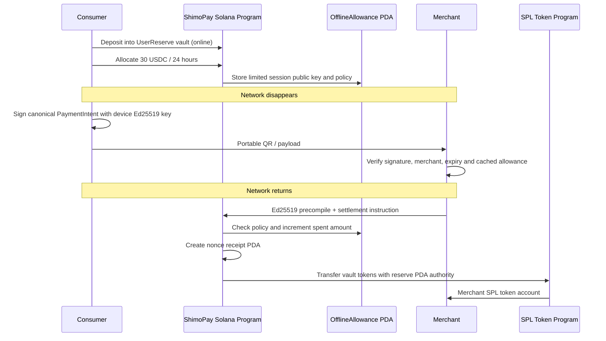

# ShimoPay

**Payments that don’t stop when the network does.**

ShimoPay is an offline-first payment authorization protocol with **Solana settlement**. A user reserves development SPL tokens online, provisions a limited Ed25519 device capability, signs a payment offline, and lets the merchant verify it locally. Once online, an Anchor program settles from the reserve vault.

Nothing touches a blockchain during offline authorization. Fully isolated merchants can accept conflicting authorizations; settlement enforces the reserve and allowance, while offline acceptance retains counterparty risk.

## Delivery status

The primary demo adapter is `SolanaSettlementAdapter`. The existing split-screen UI and PWA are preserved. See [migration acceptance gates](docs/SOLANA_MIGRATION_SPEC.md), [Solana evidence](docs/SOLANA_PROOF.md), and [business delivery controls](biz/README.md). The former EVM implementation is retained as a legacy reference, with explicit `:evm` commands; it is not the default settlement path.

**Public Devnet offline and online transactions are now verified; see the current proof below.** A local deployment or a Solana badge is not proof of Devnet deployment. Only recorded confirmed Devnet transactions will satisfy that gate.

## Architecture



The central object is the OfflineSession / OfflineAllowance: DID + device key + reserve + policy + cached FX + signed intent. This implementation uses Solana protocol v2; the old EIP-712 protocol is not wire-compatible.

## Run locally

Prerequisites: Node 24, pnpm 11.25+, Rust, Solana CLI / `cargo build-sbf` and a working local validator (or compatible Surfpool). Program code uses Anchor 0.32. Agave 4 requires `io_uring` support; in this managed container Agave 2.3.13 runs the validator successfully.

```bash
pnpm install
# On a fresh clone without the ignored program keypair:
pnpm setup:solana
pnpm build:solana
# Terminal 1:
pnpm chain
# Terminal 2:
SOLANA_RPC_URL=http://127.0.0.1:8899 pnpm deploy:solana:local
pnpm demo
# Open http://localhost:3000/demo on the machine running the app.
```

In Codex Cloud, your browser's localhost is a different machine. Use the hosted HTTPS entry documented in [CLOUD_DEMO](docs/CLOUD_DEMO.md); do not treat an old sandbox URL as permanent. The deployed cloud environment must be upgraded separately from the source checkout.

`Fund wallet` executes an actual transaction: mint 100 development tokens, deposit 50 into the reserve. `Enable offline payments` creates a 30-token, 24-hour allowance. Cache the quote, simulate offline, create a R$25 charge, sign and accept. Reconnect and settle 4.545455 tokens. Open **Solana Proof**, **Test replay**, and **Test tamper**.

## Devnet deployment

```bash
# Preserve the program keypair used for the Program ID; never commit .solana/.
SOLANA_RPC_URL=https://api.devnet.solana.com pnpm deploy:solana:devnet
# Upgrade existing code explicitly after building:
SOLANA_RPC_URL=https://api.devnet.solana.com pnpm deploy:solana:devnet -- --upgrade
pnpm demo
```

The deployer needs development SOL for program rent and account fees. The public faucet may return 429; use https://faucet.solana.com and fund the printed deployer with **Devnet SOL only**. Never fund these accounts on mainnet. Deployment scripts poll confirmation through HTTP, use the fixed cluster genesis hash and never invent signatures.

Current Program ID: `9iWAPSp9p9mbQ7LouMZEdt3qhtpnZGiaSyoCBSXDPYKg`. Exact cluster addresses and receipts are in `docs/evidence/solana-*-deployment.json` and `SOLANA_PROOF.md`; Localnet creates a fresh test mint/reserve per deployment generation; Devnet reuses official Circle USDC and its deterministic reserve. Local metadata is invalidated when the generation changes.

## Verification

```bash
pnpm build:solana
pnpm test:solana        # real local program + protocol; creates fresh mock mint/reserve
pnpm test:protocol     # retained EVM protocol / SDK regression tests
pnpm test:contracts    # retained legacy EVM contract tests
pnpm lint
pnpm typecheck
pnpm build
# Deploy a fresh local generation, start app, then:
SOLANA_RPC_URL=http://127.0.0.1:8899 pnpm deploy:solana:local
pnpm --filter @shimopay/web start
pnpm test:e2e
```

Browser tests exercise real SPL settlement, simulated network blocking, replay/tamper checks and a real offline PWA reload/unlock/sign/verify. Local tests are not Devnet Explorer evidence. See [VALIDATION](docs/VALIDATION.md) for actual results and managed-environment commands.

## Security and scope

The session seed is encrypted with PBKDF2-SHA256 (310,000 iterations) / AES-256-GCM in IndexedDB. Signing uses only that seed in memory; it never reaches the backend. Development-only master/faucet keys remain server-side in ignored files with restricted permissions; this is a shared demonstration, not production wallet custody. The API constructs fixed demo instructions and cannot accept arbitrary signing requests.

The program checks a real Ed25519 precompile immediately before settlement and binds its message reference to the current program instruction. Receipt PDAs prevent repeated nonces. Allocation, merchant binding, mint, domain, expiry and funds are enforced on-chain. Amounts use integer micro-units; cached FX is a deterministic demo rate, not an oracle or authenticated market feed. A 30-second issued-at clock-skew tolerance does not extend expiry.

See [SECURITY_MODEL](docs/SECURITY_MODEL.md), [OFFLINE_PROTOCOL](docs/OFFLINE_PROTOCOL.md), [CHAIN_ABSTRACTION](docs/CHAIN_ABSTRACTION.md), and [LIMITATIONS](docs/LIMITATIONS.md). No mainnet USDC, real fiat conversion, banking, DEX or perfect offline double-spend prevention is implemented. Circle test-USDC and Mercado Pago test-Pix paths require external funding/provider validation; public proof is pending.

### Transaction history

In `/demo`, open **Transactions** (consumer) or **Transaction history** (merchant). On-chain reserve transactions are recovered directly from Solana RPC with status, timestamp, slot, signature and pagination, including in a fresh browser. Cached history remains readable offline. On a real Devnet deployment, each signature and the reserve history link open the public Solana Explorer with `?cluster=devnet`. Localnet records are explicitly labeled and are not presented as public Devnet evidence. Public Devnet deployment and transfers are verified; current signatures are listed below.

### Public pitch deck

[Open the pitch deck](https://shimopay-demo.vercel.app/pitch.html) or [download the 11-page PDF](https://shimopay-demo.vercel.app/shimopay-pitch.pdf). The stable homepage presents the pitch and starts/resumes the working demo. Next.js also serves the deck at `/` and `/pitch`; `/demo` retains the payment experience. Content is shared from `apps/web/app/pitch/Pitch.tsx`; regenerate static assets with `node --import tsx apps/web/scripts/render-pitch.ts`. Business hypotheses and public Devnet pending status are explicitly labeled.

### Current delivery: Circle Devnet + real-rail proof

See [real-rails specification](docs/REAL_RAILS_SPEC.md) and [delivery status](docs/REAL_RAILS_STATUS.md). Devnet now requires **official Circle test USDC** (`4zMMC9srt5Ri5X14GAgXhaHii3GnPAEERYPJgZJDncDU`); deployment refuses a private mock mint or mainnet. Localnet retains an explicit engineering test token.

1. Fund the development deployer with Devnet SOL (program rent + fees), and consumer ATA with Circle faucet test USDC. Faucets: https://faucet.solana.com and https://faucet.circle.com. Test assets only.
2. Set `SOLANA_CLUSTER=devnet`, `SOLANA_RPC_URL=https://api.devnet.solana.com`, `USDC_MINT` to the official mint above; run `pnpm deploy:solana:devnet`. Preserve the existing ignored development program key; it must match the declared program ID.
3. Open `/demo`; Reserve 50 USDC deposits existing Circle tokens. Enable creates a 50 USDC/24h allowance. Signed FX is cached for up to 30min. Consumer and merchant have independent simulated connectivity; **Connect merchant only** allows settlement with the consumer offline.
4. Pix requires server-only `MERCADOPAGO_ACCESS_TOKEN=TEST-…` and `MERCADOPAGO_TEST_PAYER_EMAIL`. Provider/test-account Pix support remains a gate until an actual request succeeds. Production credentials are refused. There is no actual fiat ↔ USDC conversion or Pix payout.

Core demo actions support pt-BR/en-US. Some technical diagnostic strings remain English. Kora/Solana Pay remain P1, after real Devnet/Pix proof.

Build in this managed cloud environment: `NEXT_TELEMETRY_DISABLED=1 XDG_CONFIG_HOME=/workspace/.tooling/config XDG_CACHE_HOME=/workspace/.tooling/cache pnpm build`. These flags avoid telemetry/config writes to its read-only home directory; ordinary machines can use `pnpm build`.

### Online on-chain payment

In `/demo`, fund the test consumer, choose the BRL charge amount on the merchant side, then click **Pay online on-chain / Pagar online on-chain**. A checked SPL transfer moves unreserved wallet tokens directly to the fixed merchant ATA, confirms the transaction and updates balances. It does not consume the offline allowance or vault. **Transactions** includes online receipts and RPC history for the consumer token account. Devnet uses configured Circle test USDC; public Devnet proof remains pending funding/deployment.

The demo persists the original signed transaction before broadcast. Repeating the same request UUID returns its original confirmed signature; changed payment fields conflict. Ambiguous confirmation remains pending rather than automatically creating another transfer. Online transfers use server-managed development master accounts; offline intents still use only the encrypted limited session key. No production wallet integration, Solana Pay compatibility or Kora sponsorship is claimed. See [online payment acceptance specification](docs/ONLINE_PAYMENTS_SPEC.md).

### Public Devnet proof (funded demo)

The current hosted sandbox runs Solana Devnet with official Circle test USDC. Initial funding was 20 USDC; demonstrated reserve is 10 USDC plus a free wallet balance for direct online payments. Confirmed offline settlement: [Explorer](https://explorer.solana.com/tx/4P65dUVHm4UEo5hf7Hmis1XkEUFbmUXXU4bkii4tY2tdLcK5gwVJjRezc74vToZeYomh311eJkzdQypTukxGPauZ?cluster=devnet). Confirmed online transfer: [Explorer](https://explorer.solana.com/tx/rDBBC5tqR2cjyT5DwpHLPLUrhSvsoXYDD8XQSefjnRNsxHH1Ctfi9znL39D7DMWaoLJV8m8Nkk7axpmMdgYb1LM?cluster=devnet). These consumed 9.090910 test USDC; demo balances are real chain state and need faucet replenishment for repeated runs.

See [Cloud configuration](docs/CONFIGURE_CLOUD.md). The launcher forwards Mercado Pago test runtime variables after redeploy; actual Pix support and provider confirmation remain pending. The optional Mercado Pago MCP is agent tooling, not the app payment backend. Latest affected validation: 45 Solana tests + 8 E2E, lint/typecheck/build passed. Earlier pending/readiness notes above are historical; the original 100/50 funding scenario is not asserted.
