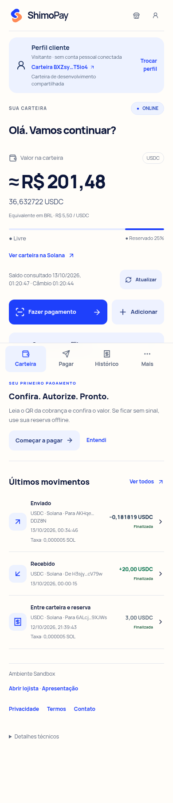

# ShimoPay Mobile

**Payments that don’t stop when the network does.**

A payment app that authorizes limited payments offline and settles Circle test USDC on Solana Devnet once a merchant reconnects. Customers see a BRL price; the signed USDC amount is fixed before authorization.

**[Open the app](https://shimopay-mobile.vercel.app) · [Pitch PT/EN](https://shimopay-mobile.vercel.app/pitch) · [Judge guide](docs/COMPETITION.md) · [Review](docs/PUBLICATION_REVIEW.md)**



**Slide decks:** [PDF Português](https://shimopay-mobile.vercel.app/shimopay-pitch-pt-br.pdf) · [PDF English](https://shimopay-mobile.vercel.app/shimopay-pitch-en-us.pdf)

## What to evaluate

- Customer and merchant experiences, balances, QR exchange and transaction receipts.
- Ed25519 session keys encrypted in IndexedDB; the master wallet does not sign offline payments.
- Solana reserve/allowance PDAs enforce amount, expiration, merchant binding and replay protection.
- Merchant verification works locally using cached session and FX data. Only settlement requires connectivity.
- On-chain history displays incoming/outgoing amounts, source, confirmation state and Explorer links.
- Pix and hosted credit-card adapters use Mercado Pago test accounts. Fiat-to-USDC conversion and real bank payouts are not implemented.

Offline acceptance carries bounded counterparty risk until settlement. Disconnected merchants cannot perfectly prevent conflicting offline authorizations. This is a test-network prototype, not a production wallet.

## Repository map

| Path | Contents |
|---|---|
| `mobile/` | Current React/Vite PWA, customer/merchant UX and browser tests |
| `programs/shimopay/` | Anchor escrow/reserve program |
| `packages/solana/` | Canonical intents, Ed25519 verification, FX and Solana adapter |
| `packages/sdk/` | Payment rails, including Mercado Pago test adapters |
| `apps/web/` | Next.js protocol demo/backend |
| `packages/contracts/` | Legacy EVM implementation; not the primary demo |
| `docs/`, `biz/` | Specifications, security model, delivery and historical evidence |

## Run the current app

Node.js 24 and npm are required. No private repository access is needed.

```bash
git clone https://github.com/dshimo0/shimopay.git
cd shimopay/mobile
npm ci
npm test
npm run build
npm start
```

Open http://localhost:8080. The default app bridge points to the hosted **shared Devnet backend**, whose availability and test funds are not guaranteed. No secrets are required to view that demo. For isolated protocol execution, use the local validator instructions in [PROTOCOL_README.md](PROTOCOL_README.md). Never supply mainnet keys or real-money credentials.

## Validate the source

```bash
# From repository root: pnpm 11.25+, Node 24
pnpm install --frozen-lockfile
pnpm test:protocol
node --import tsx --test packages/solana/test/protocol.test.ts packages/solana/test/rails.test.ts
pnpm typecheck
pnpm lint
pnpm build

# Current app
cd mobile
npm ci
npm test
npm run lint
npx tsc --noEmit
npm run build
```

Program integration additionally requires Rust, Solana CLI/build tools and a local validator; see [protocol setup](PROTOCOL_README.md). Browser tests require Chromium. Hosted provider tests are optional and must use dedicated test credentials.

## Status and evidence

Read [publication review](docs/PUBLICATION_REVIEW.md) for commands rerun on this snapshot and their results. Existing proof files retain their original dates; they are not claims of fresh transactions. [Solana proof](docs/SOLANA_PROOF.md), [mobile visual review](mobile/docs/PRODUCT_REVIEW.md), [security model](docs/SECURITY_MODEL.md).

Personal login, wallet ownership onboarding and a transactional six-digit PIN remain incomplete. Hosted wallets are shared development accounts. See [known limits](docs/LIMITATIONS.md).

## Português

O ShimoPay separa autorização offline de liquidação online. O cliente paga em moeda local; uma chave de sessão limitada autoriza o pagamento, e o lojista liquida em USDC na Solana quando recupera a conexão. O repositório reúne app, programa on-chain, testes e especificações para avaliação da competição.

## Provenance and contact

This is a source snapshot for the competition, combining the existing protocol and mobile projects. [Source provenance](docs/PROVENANCE.md). No private Git history, deployment credentials or funded wallet keypairs are included.

Contact: **shimopay@pm.me**. Third-party dependencies retain their own licenses. No additional open-source license is granted by this publication; public source access does not change ownership.
