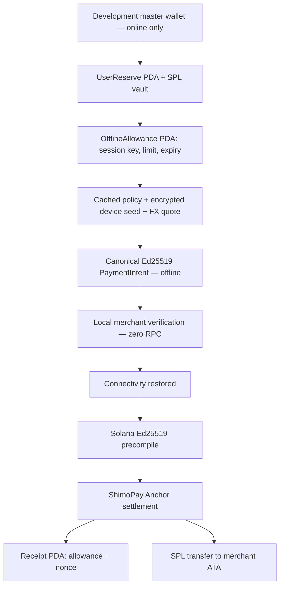

# Solana architecture

The main demo uses an Anchor program, SPL Token and Solana protocol v2. Browser cryptography and cached offline state are independent of server/RPC availability; reserve and settlement authority remain on-chain.

`packages/solana` contains the canonical protocol, DID, encrypted wallet, default browser adapter and server transaction builder. `programs/shimopay` contains all reserve/allowance/receipt policy. `/api/solana-demo` uses exclusively development server-held fee-paying keypairs; it builds supported instructions rather than accepting arbitrary transactions. This shared demo is not a production custodial service.

Program accounts are decoded after RPC confirmation; the browser caches snapshots for offline display only. The available reserve excludes allocated allowances. Settlement decrements the allocation via spentAmount and the actual vault token balance; it does not subtract a second time from availableReserve. Cancellation returns unspent allocation to availableReserve without moving vault tokens. Owner withdrawal cannot consume allocated funds.

The previous EVM packages and RPC endpoint are legacy references. No EVM calls occur in the Solana main demo.

## Online direct-payment branch

`SolanaSettlementAdapter.payOnline` invokes the bounded same-origin development API. The server verifies signed FX and fixed payer/merchant/mint, then constructs ATA creation + checked SPL transfer + ShimoPay memo with a fresh blockhash. It persists signature and signed bytes before submitting, and checks confirmation. Same request UUID reuses the original payment record. The source is the consumer ATA, not the reserve vault. Wallet-token-account RPC history complements reserve history; both can be cached offline. Session-key signing remains exclusive to the separate offline authorization branch.
