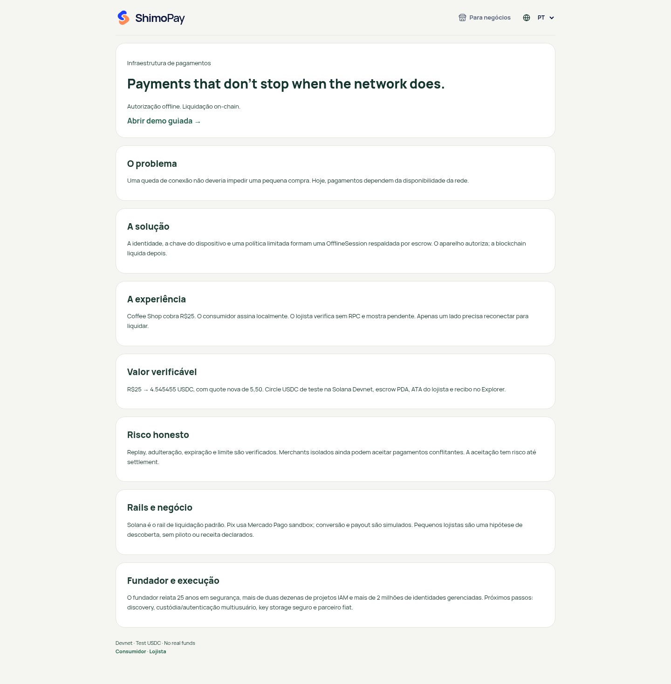

# Revisão de produto — ShimoPay

Escopo: experiência pública em 19 rotas e aliases, incluindo cliente, lojista, pagamentos, miniapps, apresentação e páginas institucionais. Objetivo: reduzir atrito e manter os estados financeiros compreensíveis. Base visual: produto publicado; manter marca azul/marfim, mesma navegação e hierarquia.

## Auditoria e correções

| Etapa | Observação inicial | Correção / estado |
|---|---|---|
| 1. Início e onboarding | Onboarding antigo coletava dados e simulava etapas que não pertencem ao fluxo financeiro atual. | Entrada direta: pagar ou receber; sem KYC fictício. |
| 2. Carteira e navegação | Perfil já identificável; textos pequenos e idioma parcialmente traduzido. | Português consistente, controles/foco visíveis e maior legibilidade. |
| 3. Pagamento e reserva | Termos técnicos, valores com separador inconsistente, detalhes exportados abertos por padrão. | Vírgula decimal, mensagens acionáveis, dados técnicos recolhidos. Preservada revisão antes de pagar. |
| 4. Lojista e pendências | Sessão já validada, mas aliases antigos expunham notificações fictícias. | Pendências reais do aparelho; sessão automática online e cache obrigatório offline mantidos. |
| 5. Histórico e comprovantes | Recibos verificáveis já existentes; tela de rede antiga gerava hashes aleatórios. | Alias da rede passa ao histórico verdadeiro; origem, valor, assinatura e tracker preservados. |
| 6. Miniapps | Catálogo por perfil já unificado. | Mantido e verificado nas três larguras, sem parceiros inventados. |
| 7. Conta e suporte | Perfil/admin antigos usavam identidade e registros mock; 404 em inglês e fora do estilo. | Aliases para autenticação existente; 404 em português com retorno à carteira. Login continua indisponível quando não configurado. |
| 8. Apresentação e páginas legais | Pitch verde antigo, texto denso, termos em inglês no PT; páginas legais já atualizadas. | Pitch azul/marfim com passos e grade responsiva, PT/EN; contato e Sandbox consistentes. |

## Evidência inicial aceita

As capturas abaixo são desta revisão, antes das alterações. Capturas financeiras obtidas durante carregamento foram descartadas como prova de estado final.

## Verificação

- 68 testes unitários, lint sem erros (8 avisos de Fast Refresh existentes), typecheck/build.
- 10 E2E distintos: fluxo offline com dois navegadores, câmera/GPS/caixa, seleção dos meios, espera real da promessa de liquidação, sessão automática, recibo/cache/PDF e rotas responsivas.
- 19 rotas em 320, 390 e 1440 px: nenhuma rolagem horizontal; marca e título presentes; marcadores internos e notificações inventadas ausentes.
- Testes financeiros usam fixtures identificadas; não demonstram nova aprovação Mercado Pago nem movimentação nova na Devnet.
- Não é uma auditoria WCAG completa: leitor de tela, contraste de todos os estados, teclado físico em dispositivos e câmera real ainda requerem avaliação específica.
- A autenticação por conta permanece condicionada à configuração; PIN transacional/ownership de carteira não são apresentados como entregues.

## Registro visual final

Versão publicada: https://shimopay-mobile.vercel.app — revisão runtime `0a33302`, 13/10/2026. A inspeção inicial identificou dois ajustes adicionais: estado vazio indevido junto de transações on-chain e contraste dos links de ação em fundo azul. Ambos foram corrigidos antes das capturas finais.

| Jornada | Saúde visual / funcional observada | Evidência |
|---|---|---|
| 1. Entrada | Consistente; escolha cliente/lojista direta | [Onboarding](evidence/review-after/14-onboarding.png) |
| 2. Carteira | Perfil e carteira identificados; saldo consultado e equivalente BRL | [Cliente](evidence/review-after/02-customer-home.png) |
| 3. Pagamento | Valor em reais; meios distintos; autorização offline separada | [Pagar](evidence/review-after/03-customer-scanner.png) |
| 4. Lojista | Identidade visual compartilhada; ações específicas do perfil | [Lojista](evidence/review-after/07-merchant-dashboard.png) |
| 5. Histórico | Entradas/saídas com valores, origem e estado; vazio condicionado à ausência de registros | [Histórico](evidence/review-after/05-customer-history.png) |
| 6. Miniapps | Catálogo dentro do shell, ferramentas por perfil | [Cliente](evidence/review-after/06-customer-stores.png) |
| 7. Conta | Bloqueio de autenticação explicitado; sem identidade fictícia | [Conta](evidence/review-after/10-auth.png) |
| 8. Apresentação | Mesma tipografia, cores e ações; PT/EN | [Pitch](evidence/review-after/desktop-pitch.png) |

[Inventário público](evidence/review-after/audit.json): 19 rotas móveis e três capturas desktop; nenhum erro de página ou overflow horizontal. As capturas financeiras aguardam o fim do carregamento. Navegação fixa inferior aparece na posição do viewport original nas imagens de página inteira; não representa uma barra inserida no meio do conteúdo.

Verificação pública somente de leitura: saldo e histórico consultados, sem nova transferência ou cobrança. Nenhuma credencial foi usada como conteúdo de evidência.
