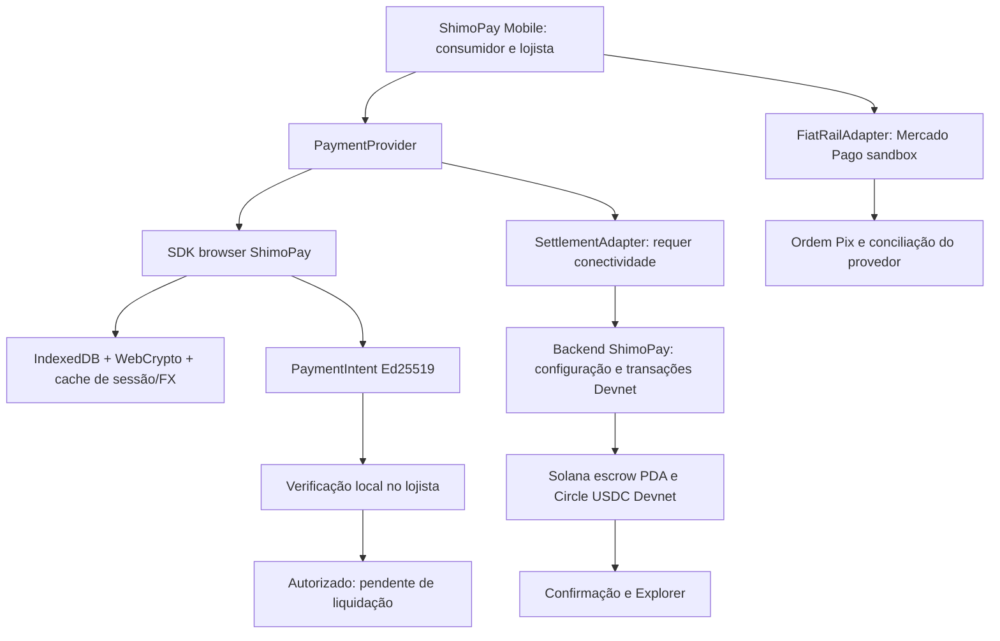

# ShimoPay Mobile + protocolo Solana: avaliação anterior à integração

> Documento histórico da avaliação. A implementação foi concluída depois; estado atual em [progress](progress.md) e [SPEC](../SPEC.md).

Data: 2026-10-12. Avaliação do Mobile em `c66b08a8e44bcae2cec901a2ceec8abf14b5bff3` e do MVP Solana em `2606c9e2406b1798f63ae345119cb23b785c7486`.

## Decisão recomendada

Usar **shimo-pay-mobile como interface do produto** e integrar a camada de pagamentos de **shimopay_solana**. Manter `/demo` no projeto Solana como demonstração técnica e suíte de referência. Não portar a infraestrutura financeira para o `MockContext` nem reescrever os contratos/programa.

Esta avaliação não implementa a integração. Os critérios abaixo são entregáveis futuros, não funcionalidades concluídas. Nenhuma transação financeira foi criada nesta revisão.

## Comparação baseada no código

| Área | Mobile hoje | MVP Solana hoje | Tratamento recomendado |
| --- | --- | --- | --- |
| Produto | Navegação de consumidor, carteira, histórico, perfil, cobrança e lojista; React/Vite | Fluxos online/offline e views separadas de consumidor/lojista; Next.js | Reutilizar componentes e navegação Mobile |
| Saldo | Ledger local `MockContext`, valores demonstrativos adicionais na carteira | Leitura de ATA, reserva e merchant na Devnet | Provider on-chain separado; distinguir livre, reservado e comprometido localmente |
| Offline | Regras puras testadas; tela de assinatura usa temporizador | Ed25519, session key criptografada, cache, intents e settlement | Consumir SDK; substituir temporizadores e vouchers não assinados |
| Histórico | Entradas locais; fontes diferentes de persistência | Histórico Devnet e status locais de intents | Exibir origem, autorização, pendência, confirmação e Explorer |
| Identidade | Login local, DIDs demonstrativos | DID associado ao endereço e à sessão | Login demo não autoriza movimentação; vincular wallet e sessão |
| Pix | BR Code EMV/CRC16 e QR de chave configurada; sem confirmação do provedor | Orders API Mercado Pago cria ordem teste; QR ainda não retornado nos testes registrados | Manter rail independente; não creditar saldo USDC com QR/ordem pendente |
| Biometria | WebAuthn local sem verificação server-side; PIN demo | Senha de session key/WebCrypto | Não reutilizar PIN demo ou assertion não verificada como autenticação financeira |
| Offline reload | Sem service worker/manifest/registro PWA encontrado | PWA testada, cache de assets e IndexedDB | Implementar PWA especificamente para o bundle Vite |
| Framework | React 18, Vite, React Router, Zod 3 | Next.js, SDK Solana com Zod 4 | Integrar pelo pacote browser; não copiar componente Next ou atualizar dependências sem teste |

Fontes Mobile: `src/App.tsx`, `src/contexts/MockContext.tsx`, `src/pages/customer/{Home,Wallet,Offline,QR,Scanner}.tsx`, `src/pages/merchant/Dashboard.tsx`, `src/domain/{ledger,offline,brcode}.ts`, `src/lib/webauthn.ts`, `docs/architecture.md`.

Fontes Solana: `packages/solana/src/{index,protocol,fx,online}.ts`, `packages/sdk/src/storage.ts`, `apps/web/app/api/solana-demo/route.ts`, `docs/APP_UX_SPEC.md`. A implementação Solana também usa contas de desenvolvimento configuradas, não autenticação e custódia multiusuário de produção.

## Limitações que impedem tratar o Mobile atual como app financeiro

- `Offline.tsx` mostra R$180 e filas fixas; `startHandshake()` apenas espera 1,4s e mostra "assinado".
- `Scanner.tsx` abre pagamento por temporizador e chama `useMock().pay()`, inclusive quando a forma selecionada se chama Pix/cartão.
- `Dashboard.tsx::completeReceive()` credita o ledger local e mostra "recebido e sincronizado" sem verificar intent ou confirmação on-chain.
- `QR.tsx` usa token rotativo demonstrativo; ele não equivale a PaymentIntent assinado.
- `MockContext` salva usuário/saldo em localStorage e reconstitui histórico inicial em memória. Não é fonte de verdade financeira nem autorização.
- Gerar um BR Code pagável não integra confirmação Pix, conciliação ou conversão USDC.
- O nome Mobile descreve uma SPA responsiva; não foi identificado aplicativo nativo com armazenamento de chaves protegido pelo sistema operacional.

## Arquitetura de integração

O SDK browser não deve importar server modules, secrets ou arquivos de keypair. Publicar/consumir os pacotes compartilhados com versões fixadas e compatibilidade de Zod resolvida no limite do pacote. Evitar uma cópia divergente do protocolo nos dois repositórios.

Para a primeira integração, o Vite pode usar proxy para o backend durante desenvolvimento. Na hospedagem, preferir gateway de mesma origem para `/api`; se usar origens separadas, definir autenticação, CORS restrito e política de cookies explicitamente. Não chamar RPC/backend no caminho de assinatura ou verificação offline. Não basta colocar um link/iframe para `/demo`.

`PaymentProvider` deve fornecer saldo da cadeia com timestamp, sessões e status de pagamento. `MockProvider` continua reservado às telas de demonstração até serem migradas. Saldos BRL demonstrativos não são migrados para USDC. IDs de intents e assinaturas de transações devem substituir IDs numéricos locais na área financeira integrada.

## Entregáveis técnicos e de negócio

Todos os itens abaixo estão **PLANEJADOS**.

| Prioridade | Entregável técnico | Resultado de negócio | Critério de aceite |
| --- | --- | --- | --- |
| P0.1 | PaymentProvider + SDK browser compartilhado + adapter Devnet | Uma interface de produto com valor verificável | Mostrar saldo ATA e escrow da conta configurada, mint Circle, timestamp e links reais; nunca usar saldo mock como fallback |
| P0.2 | Pagamento online nativo na UX Mobile | Pagar quando a rede existe | Consumidor confirma cobrança BRL; merchant recebe USDC; histórico mostra assinatura e confirmação; retries não geram pagamento duplicado |
| P0.3 | OfflineSession nativa | Pagamento continua sem conectividade | Reserva on-chain; chave limitada criptografada; bloquear/desbloquear/apagar; exibir limite, expiração, DID e snapshot |
| P0.4 | Cobrança, assinatura e recebimento offline | Consumidor e lojista usam o mesmo protocolo | Payload/QR; zero RPC/backend com rede bloqueada; merchant binding, FX cacheado, assinatura local válida; estado pendente sem crédito confirmado |
| P0.5 | Liquidação, reconciliação e histórico | Lojista sabe o que recebeu e o que está em risco | Apenas uma parte precisa conectar; merchant liquida; timestamp da autorização separado da confirmação; falha visível; Explorer apenas com assinatura real |
| P0.6 | PWA Vite e testes adversariais | Uso demonstrável em modo avião | Reabrir app offline após visita; assets/rotas lazy necessários cacheados; intent pendente sobrevive reload; replay, alteração e excesso rejeitados |
| P0.7 | Revisão das alegações visuais | Pitch e produto mostram o mesmo comportamento | Remover mensagens de assinatura/sincronização de fluxos simulados; diferenciar mock, sandbox e Devnet; PT-BR e EN-US |
| P1 | Pix sandbox confirmado pelo provedor | Demonstrar o rail fiat separadamente | Ordem real teste, QR retornado, consulta/webhook validado, status confirmado; conversão fiat/USDC explicitamente simulada enquanto não houver bridge |
| Produção | Wallet connection, autenticação/verificação server-side, multiusuário e armazenamento seguro | Usar com contas próprias | Projeto de segurança e testes próprios; não liberar fundos reais com login/PIN demo ou chaves de desenvolvimento hospedadas |

Preservar miniapps existentes, mas não ampliar loyalty, cashback, token ou outros recursos antes de fechar pagamentos. Não existe entrevista, piloto, conversão comercial ou validação de demanda demonstrada por esta revisão de código.

## Matriz de testes de aceite

1. Online: saldo antes/depois, transferência USDC, merchant ATA, confirmação e Explorer.
2. Offline real: preparar sessão/cache online, cortar rede no browser, reabrir, cobrar, assinar e verificar sem requests; persistir e retomar pendência.
3. Reconexão somente do merchant: liquidar com payer ainda offline, reconciliar posteriormente no payer.
4. Replay, merchant errado, assinatura/valor alterados, quote/intent/session expirados, sessão revogada, allowance excedida.
5. Recovery: refresh, senha incorreta, wallet bloqueada, transação pendente, retry e erro RPC não criam duplicidade ou sucesso falso.
6. Pix: QR não retornado permanece processing; ordem pendente não altera saldo confirmado nem dispara transferência USDC.

Separar `authorized_offline`, `pending_settlement`, `submitted`, `confirmed`, `rejected` e `expired`. Sessão tem estados próprios. Nunca tratar disponibilidade local após assinatura como leitura atual da cadeia. Merchants isolados podem aceitar intents conflitantes; escrow limita gasto on-chain, não elimina perdas agregadas de contrapartes.

## Verificação executada nesta avaliação

- `npm ci --no-audit --no-fund`: instalação concluída.
- `npm test`: **32 testes, 4 arquivos, todos passaram**.
- `npm run build`: passou, Vite 7.3.6 conforme lockfile.
- `npx tsc --noEmit -p tsconfig.app.json`: passou; configuração atual tem `strict: false`.
- `npm run lint`: passou, **0 erros e 8 avisos** de Fast Refresh existentes.
- Inspeção Chromium em viewport 390x844: home, wallet, offline e dashboard de merchant; evidência em `docs/evidence/mobile-reuse-review.json` e screenshots correspondentes. Usuário local de teste, sem autenticação server-side e sem movimentação financeira.

Testes de domínio não validam assinatura, blockchain, PWA ou segurança do Mobile. Esses critérios são parte da integração a executar, não conclusão da suíte atual.
