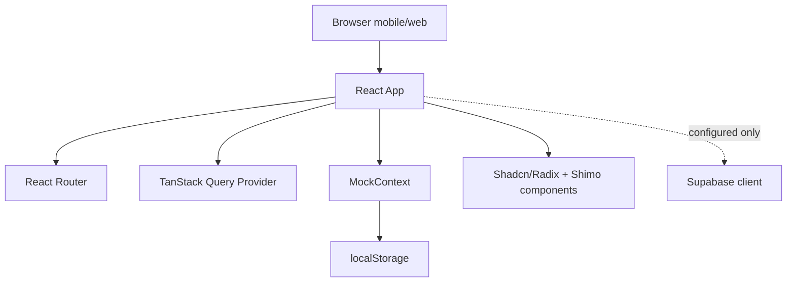
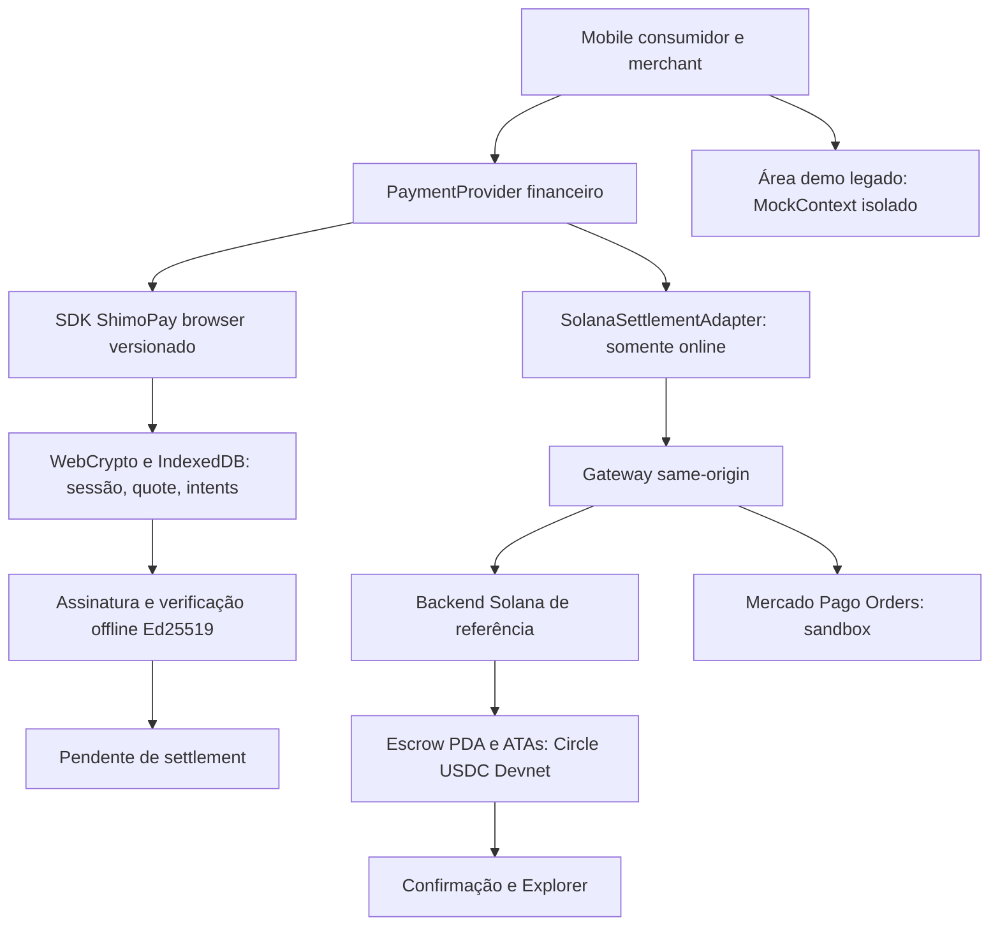

# ShimoPay Architecture

Este documento descreve a arquitetura confirmada pelo repo. Ele nao assume backend, blockchain, pagamentos reais ou parceiros sem fonte.

## Runtime legado — baseline antes da integração

`CONFIRMED` ShimoPay e um SPA React servido por Vite. Fonte: `package.json`, `vite.config.ts`, `src/main.tsx`.

## Camadas

- `CONFIRMED` Entrada: `src/main.tsx` monta `App` no `#root`.
- `CONFIRMED` Providers: `QueryClientProvider`, `MockProvider`, `TooltipProvider`, toaster e router. Fonte: `src/App.tsx`.
- `CONFIRMED` Rotas: landing, onboarding, auth, customer pages, merchant dashboard, network explorer, legais (`/privacidade`, `/termos`), backoffice (`/admin`) e fallback 404. Fonte: `src/App.tsx`.
- `CONFIRMED` Dominio puro (sem React/IO, testado): `src/domain/ledger.ts`, `src/domain/offline.ts`, `src/domain/audit.ts`. Testes em `src/domain/__tests__/` via Vitest (`npm test`).
- `CONFIRMED` UI base: componentes Shadcn/Radix em `src/components/ui/*`.
- `CONFIRMED` Design Shimo: shell, simbolos e ilustracoes em `src/components/shimo/*`.
- `CONFIRMED` Miniapps: componentes em `src/components/miniapps/*`.

## Mapa Mock vs Real (Milestone 04)

Onde cada feature sensivel busca estado hoje. Nenhuma linha abaixo e pagamento real.

| Feature | Provider atual | Persistencia | Provider real (alvo) |
| --- | --- | --- | --- |
| Saldos/transacoes do cliente | `MockContext` (mock) + dominio puro | `shimo_user`; entradas em memoria | Backend/ledger real `NEEDS_DECISION` |
| Lojas e transacoes locais | `src/lib/storage.ts` | `shimopay_stores`, `shimopay_transactions` | Backend `NEEDS_DECISION` |
| Auth | `MockContext.login` (mock) | `shimo_user` | Supabase Auth configurado, nao conectado |
| KYC/onboarding | Simulacao visual | `shimo_onboarded` | Provedor KYC `NEEDS_SOURCE` |
| Reserva offline | `src/domain/offline.ts` (regras) + UI simulada | memoria da tela | Assinatura/liquidacao real `NEEDS_SOURCE` |
| QR Code visual | `qrcode` lib — matriz REAL renderizada em `ShimoQrCode` | nenhuma | — |
| BR Code Pix (receber/cobrar) | `src/domain/brcode.ts` EMV+CRC16, chave via `/admin` (`pixConfig`) | `shimopay_pix_config` | Provedor de cobranca + webhook + backend `NEEDS_DECISION` |
| Biometria na confirmacao | WebAuthn platform authenticator (`src/lib/webauthn.ts`) — REAL local | `shimo_webauthn_credential` | Verificacao de assinatura em servidor; liveness/KYC licenciado `NEEDS_SOURCE` |
| Cripto/USDC/USDT/cambio | UI simulada | nenhuma | Rails/custody `NEEDS_SOURCE` |
| Relatorios/explorer | random/temporizadores | nenhuma | Backend + analytics `NEEDS_DECISION` |
| LGPD (consentimento, exportar, apagar) | `src/lib/privacy.ts` — REAL sobre dados locais | `shimo_privacy_consent` + chaves `shimo*` | DPO/canal/backend `NEEDS_SOURCE` |
| Backoffice `/admin` | `src/pages/admin/Admin.tsx` + `src/lib/adminStore.ts` | `shimopay_audit_log`, `shimopay_admin_user_status` | RBAC/auditoria de servidor `NEEDS_DECISION` |

## Estado E Dados

### MockContext

`CONFIRMED` `src/contexts/MockContext.tsx` controla usuario, transacoes, login/logout, pagar e receber.

- Regras de saldo/pontos/historico delegadas ao dominio puro `src/domain/ledger.ts`; o contexto so faz binding React + rotulos de data.
- Usuario salvo em `localStorage` sob `shimo_user`.
- Login cria usuario demo cliente ou lojista (`DEMO_ACCOUNTS`).
- Pagamento debita saldo local e insere transacao em memoria via `pay()` do dominio (falha nao altera estado).
- Recebimento credita saldo local via `receive()` do dominio.

`PARTIAL/MOCK` Este contexto nao representa ledger financeiro real, conciliacao, antifraude, KYC ou autorizacao.

### Local Storage Helpers

`CONFIRMED` `src/lib/storage.ts` possui helpers para lojas e transacoes em `localStorage`.

- Chaves: `shimopay_stores`, `shimopay_transactions`.
- Usa `crypto.randomUUID()` quando disponivel, com fallback em `Math.random()`.

`PARTIAL` Nem todas as telas usam esses helpers; varias usam `MockContext` diretamente.

### Supabase

`CONFIGURABLE/PARTIAL` Supabase client existe em `src/integrations/supabase/client.ts` e usa:

- `VITE_SUPABASE_URL`
- `VITE_SUPABASE_PUBLISHABLE_KEY`

`CONFIRMED` `src/integrations/supabase/types.ts` nao declara tabelas publicas. Busca no repo nao encontrou uso funcional do client fora do arquivo gerado.

## Pagamentos E Offline

`PARTIAL/MOCK` Pagamento por scanner e aproximacao e simulado por temporizadores e drawers de confirmacao. Fonte: `src/pages/customer/Scanner.tsx`.

`PARTIAL/MOCK` QR e token offline sao gerados localmente para demonstracao. Fonte: `src/pages/customer/QR.tsx`.

`PARTIAL/MOCK` Reserva offline, comprovante assinado, fila de sincronizacao e DID handshake sao experiencia visual/local. Fontes: `src/pages/customer/Offline.tsx`, `src/components/DIDHandshake.tsx`.

`NEEDS_DECISION` Arquitetura real de offline payment deve definir allowance, assinatura, validade, contador, device/merchant identity, risco, liquidacao e reconciliacao.

## Seguranca

- `PARTIAL/MOCK` Auth local nao valida credenciais contra backend. Fonte: `src/pages/Auth.tsx`, `src/contexts/MockContext.tsx`.
- `PARTIAL/MOCK` PIN, biometria, dispositivos confiaveis e modo rua sao UI/estado local. Fontes: `src/pages/customer/Scanner.tsx`, `src/pages/customer/Profile.tsx`.
- `CONFIGURABLE` Supabase Auth esta configurado com persistencia em `localStorage`, mas nao conectado ao fluxo atual. Fonte: `src/integrations/supabase/client.ts`.
- `NEEDS_SOURCE` Qualquer claim de seguranca criptografica, identidade DID, biometria, KYC ou protecao de fundos precisa de implementacao e fonte.

## Build E Deploy

- `CONFIRMED` Build: `vite build`.
- `CONFIRMED` Preview: `vite preview`.
- `CONFIGURABLE` `vite.config.ts` define `server.host = "::"`, `server.port = 8080` e `preview.allowedHosts = ["shimopay-crudv1-jgfbe.ondigitalocean.app"]`.
- `UNKNOWN` Nao foram encontrados Dockerfile, docker-compose, CI/CD ou manifestos de infraestrutura.

## Riscos Tecnicos

- Estado financeiro mockado e local pode mascarar requisitos de backend.
- Duas fontes de transacao coexistem (memoria do `MockContext` e `shimopay_transactions`); o mapa acima documenta quem usa o quê, mas a unificacao depende do backend.
- Suite de testes cobre o dominio puro; telas React seguem sem testes de componente/E2E.
- Bundle atual passa build, mas Vite alerta chunk acima de 500 kB.
- Browserslist/caniuse-lite esta desatualizado no build.

## Direção histórica — substituída para o marco da demo pelo SPEC v2

1. `NEEDS_DECISION` Definir entidades de dominio antes de expandir UI: user, account, wallet, merchant, transaction, payment_intent, offline_allowance, offline_voucher, miniapp.
2. `NEEDS_DECISION` Escolher backend principal e fronteiras de responsabilidade: Supabase, API propria ou hibrido.
3. `NEEDS_DECISION` Separar mocks de providers reais com adapters explicitamente nomeados.
4. `NEEDS_DECISION` Criar testes para contrato minimo de pagamento, offline queue, auth state e merchant receiving antes de backend real.

## Arquitetura integrada da demo — implementada em 2026-10-12

Decisão fechada em [SPEC](../SPEC.md): conservar Mobile React/Vite e adicionar PaymentProvider/SDK browser/gateway para backend Solana existente. Supabase não precisa ser conectado para as contas de desenvolvimento desta demo. Não transformar o ledger mock em saldo real.

Export browser não inclui server modules, keys ou secrets. API/gateway valida origem/config/ações; sem CORS wildcard. Deploy/config e keypairs do backend são preservados. PWA cacheia assets/rotas necessários, não RPC/respostas financeiras/secrets. Segundo browser merchant prepara cache confiável online. Fiat conversion/payout permanecem simulação, independente do settlement USDC.

Estado atual comprovado em [progress](progress.md). A baseline acima descreve somente o legado, preservado em rotas preview. O provider financeiro usa SDK browser snapshot local versionado, IndexedDB/WebCrypto e gateway Vercel para o backend Solana. Supabase não é usado no caminho financeiro.
